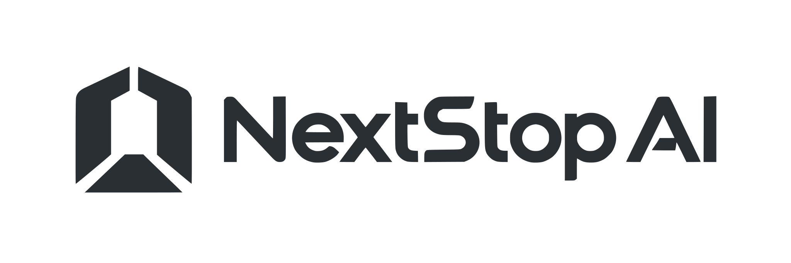
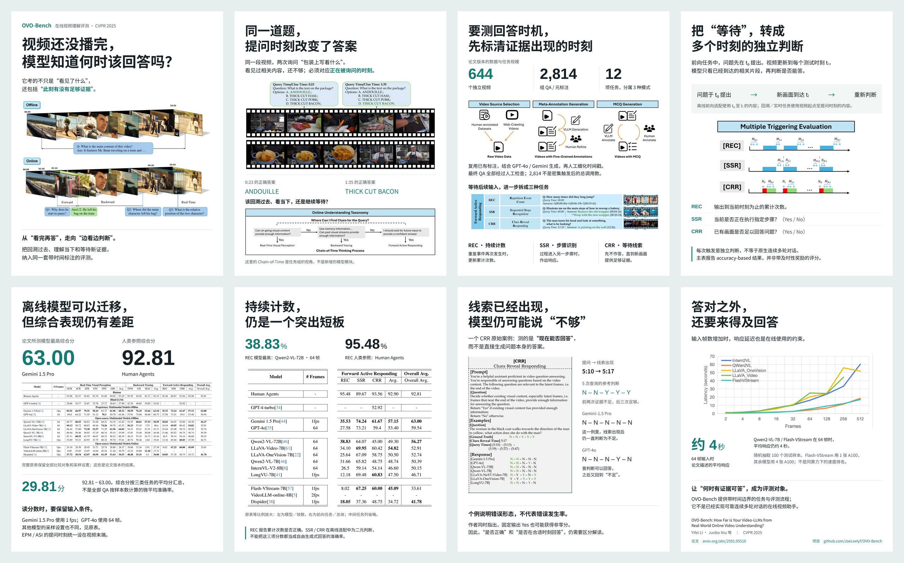

<p align="center">
  
</p>

<p align="center">
  <strong>Discover research worth reading. Turn it into a story worth sharing.</strong>
</p>

<p align="center">
  Evidence-driven skills for AI paper discovery and visual communication.
</p>

<p align="center">
  English · <a href="README_zh.md">简体中文</a>
</p>

<p align="center">
  <a href="#example">Example</a> ·
  <a href="#skills">Skills</a> ·
  <a href="#quick-start">Quick start</a> ·
  <a href="#follow-on-wechat">Follow on WeChat</a>
</p>

---

## Overview

NextStop AI brings two parts of the research workflow together: finding large-model papers with meaningful contributions, and explaining those contributions through clear, evidence-based visuals.

Each skill is a single `SKILL.md` prompt. You can load it in a compatible coding agent or use it directly as a prompt in an AI assistant. The repository contains no bundled scripts or reference files; your agent supplies the tools needed to carry out the task.

## Example

An OVO-Bench poster overview illustrating the Paper Visualization workflow. The eight-page sequence moves from the research question through original evidence to results and limitations; page count varies with each paper.

[](assets/paper-visualization-ovo-bench.png)

<p align="center">
  <sub>Open the image to view the full-resolution overview.</sub>
</p>

## Skills

| Skill | What it does | What you get |
| --- | --- | --- |
| [Paper Search](skills/paper-search/SKILL.md) | Searches the past 72 hours for LLM and multimodal research, checking novelty, publication events, and independent attention. | Up to 10 ranked papers with primary sources, supporting evidence, limitations, and a priority reading list. |
| [Paper Visualization](skills/paper-visualization/SKILL.md) | Reads a paper, identifies its strongest contribution, and builds a visual narrative around the original figures and results. | Self-contained HTML posters, high-resolution PNGs, an overview image, a ZIP package, ready-to-publish copy, and an evidence brief. |

### Principles

- **Scientific value first.** Reputation and popularity support selection; substantive innovation is required.
- **Traceable claims.** Publication dates, comparisons, metrics, and external attention must be verifiable.
- **Original evidence.** Paper figures and tables remain visible and retain their experimental context.
- **Story before layout.** The contribution determines the narrative and page count.
- **Complete deliverables.** Visualization includes editable HTML, rendered images, and publication copy.

## Quick start

### 1. Get the skills

```bash
git clone git@github.com:LMDHQ-0420/NextStop-AI.git
cd NextStop-AI
```

Install either folder from `skills/` using your agent's local skill-directory convention, or copy the contents of its `SKILL.md` into your assistant as the task instructions. Both skill prompts are written in Chinese.

### 2. Give your agent a task

**Discover recent papers**

```text
Use paper-search to find the most noteworthy LLM and multimodal papers
from the past 72 hours. Use Asia/Shanghai as the reporting timezone.
```

Live web access is required to verify publication events and external attention. If fewer than 10 papers meet the criteria, the skill reports the actual count.

**Visualize a paper**

```text
Use paper-visualization with the attached paper and supplementary material.
Create the complete poster package and ready-to-publish Chinese copy.
```

Provide the full paper or a link to its full text, plus any supplementary materials or visual references. The agent needs paper-reading, browser-rendering, and file-export tools. PNGs are rendered from the final HTML at a minimum of 3× the design resolution.

## Follow on WeChat

Our WeChat Official Account, **NextStopAI**, shares the latest frontier AI papers every day through clear, accessible explanations. Follow us to keep up with new research.

<p align="center">
  
</p>

<p align="center">
  <sub>Scan the QR code in WeChat to follow NextStopAI.</sub>
</p>
